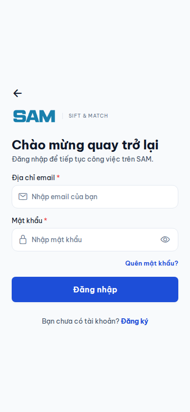
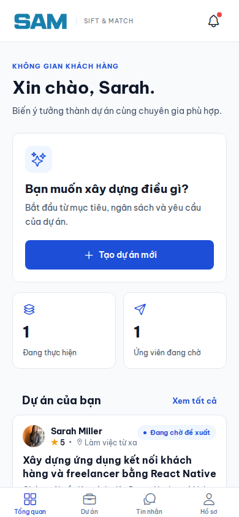
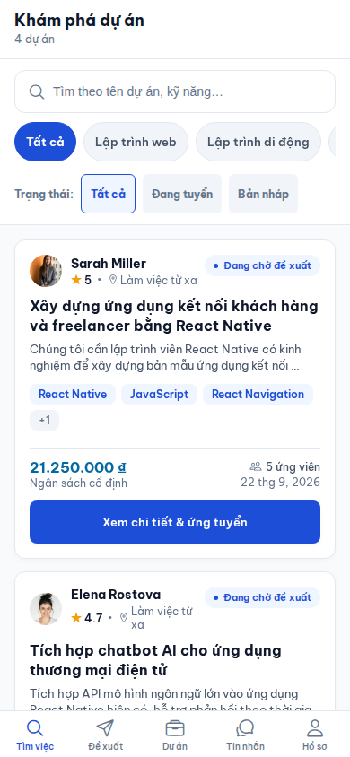
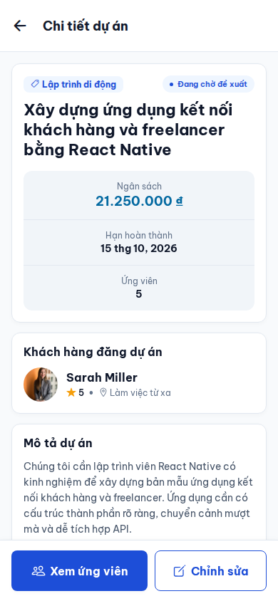
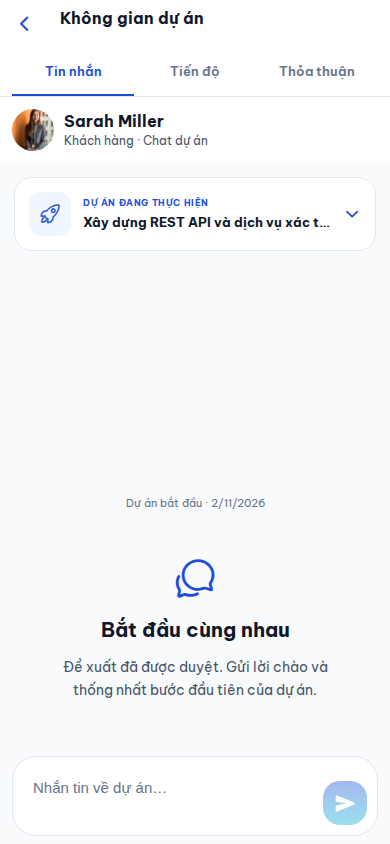
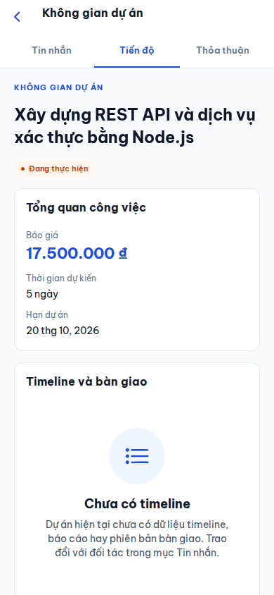

# SAM mobile: thiết kế và phạm vi triển khai

## Chuẩn giao diện

Nguồn đối chiếu: `sam-fe/src/index.css`, `AppHeader.tsx`, `JobStatusBadge.tsx`, `ProjectWorkflowPanel.tsx`; backend `ProjectWorkflowController` và đặc tả hệ thống.

| Thành phần | Quy tắc mobile |
| --- | --- |
| Nhận diện | Wordmark SAM lấy từ web; icon SAM có nguồn SVG đi kèm |
| Màu | Primary #1D4ED8, nền #F8FAFC, surface #FFFFFF, viền #E2E8F0, chữ #0F172A |
| Chữ | Be Vietnam Pro 400/500/600/700 đóng gói cùng app |
| Hình dạng | Card 12px; control 8px; badge hình viên thuốc |
| Tương tác | Nút chính tối thiểu 48px, vùng chạm điều hướng/bộ lọc tối thiểu 44px |
| Nội dung | Tiếng Việt, ngày vi-VN, bộ dữ liệu mẫu dùng VND |
| Trạng thái | Nhãn và màu tập trung tại src/constants/statuses.js, nhận cả enum hoa và giá trị mock thường |

## Đã triển khai

- Expo Router tại `src/app/`, bảo vệ màn hình theo phiên đăng nhập và vai trò; các màn hình cũ nhận navigation qua adapter để tiếp tục hoạt động trong quá trình chuyển đổi.
- Luồng chào mừng, đăng nhập, đăng ký dùng nhận diện SAM, bỏ tài khoản điền sẵn và thao tác đổi người dùng trên hồ sơ.
- Dashboard theo vai trò; bỏ quảng cáo và danh sách chuyên gia hardcode khỏi trang chủ.
- Client: Tổng quan, Dự án, Tin nhắn, Hồ sơ. Freelancer: Tìm việc, Đề xuất, Dự án, Tin nhắn, Hồ sơ; dashboard Freelancer vẫn có route /home.
- Nút tạo dự án chỉ xuất hiện với Client, route tạo dự án có guard; route ứng tuyển dành cho Freelancer.
- Danh sách, chi tiết, form đăng dự án, đề xuất, thông báo, hồ sơ và gói mẫu dùng chung màu, chữ, nút và badge.
- Inbox thành màn hình riêng; workspace có Tin nhắn, Tiến độ và Thỏa thuận. Chat và dữ liệu đề xuất hiện có vẫn hoạt động.
- Tiến độ hiển thị tổng quan và trạng thái chưa có timeline; Thỏa thuận hiển thị đề xuất đã duyệt. Không tạo task, hợp đồng hay khoản thanh toán giả cho dự án.

## Phần tích hợp nghiệp vụ còn lại

Ứng dụng hiện vẫn dùng `services/mock/service.js` qua repository; bản này thực hiện tái thiết kế và chuyển đổi điều hướng, chưa hoàn tất plan tích hợp backend. Dữ liệu mock được ghi rõ tại lớp service; giá gói mẫu cần lấy từ API khi triển khai thật.

1. Auth API, refresh/session trên thiết bị, profile, danh sách và bộ lọc phân trang.
2. Draft có revision và tự lưu; AI BA → duyệt SRS → Risk → xác nhận đăng; API add-on.
3. Proposal/lời mời/claim và bắt tay hai chiều đúng backend; mock hiện còn luồng duyệt và bắt đầu trực tiếp.
4. STOMP chat và hợp đồng; ký đôi, AI thẩm định, xác nhận lại; màn funding và callback VNPay.
5. Timeline summary → báo cáo task; bàn giao phiên bản → checklist QA → chỉnh sửa/nghiệm thu; hiển thị quyết toán sandbox.
6. Thông báo realtime và ví; push cần hạ tầng đăng ký thiết bị tương ứng.

Các hành động nghiệm thu phải theo backend: Freelancer báo cáo khi IN_PROGRESS; tất cả task 100% và SUBMITTED/ACCEPTED mới bàn giao; Client duyệt delivery SUBMITTED; quyết toán hiện là sandbox. Không triển khai quét GitHub, Scope Shield hoặc bàn giao cloud khi chưa có API thực tế.

## Chạy và kiểm tra

- `npm ci`
- `npm run start` / `npm run web`
- `npm run lint`, `npm run typecheck`, `npm test`
- `npx expo export --platform android` kiểm tra đóng gói native; đây không phải kiểm thử trên thiết bị.
- `tsconfig.json` cho phép chuyển đổi dần từ JavaScript; kiểm tra strict áp dụng cho file TypeScript mới, các file JS cũ chưa bật checkJs.

Dùng tài khoản mẫu `customer@example.com` hoặc `freelancer@example.com`, mật khẩu `123456`. Bản preview không tự đăng nhập. Đăng xuất để xem hai vai trò.

Ảnh kiểm tra được lưu trong `docs/previews/`. Đây là ảnh ứng dụng qua React Native Web ở viewport điện thoại, cần kiểm tra bổ sung safe area, bàn phím và cử chỉ trên Android/iOS thật.

## Ảnh xem nhanh

| Đăng nhập | Dashboard Client | Tìm việc |
| --- | --- | --- |
|  |  |  |

| Chi tiết dự án | Workspace chat | Tiến độ chưa có dữ liệu |
| --- | --- | --- |
|  |  |  |

Kiểm chứng ngày 2026-11-02: lint và typecheck đạt; hai bộ test projectForm/projectChat đạt; export web và Android đạt. Kiểm tra trình duyệt ở 320px/390px: khách, đăng nhập bằng form, hai vai trò, dự án/chi tiết và workspace; không có lỗi runtime hoặc tràn ngang. Sau khi bổ sung nút quay lại workspace, đã kiểm tra lại chat/timeline ở cả hai kích thước.
